

  

  

  

    
    
    
    
  

  AI student · Machine learning specialization · Applied research · Startup builder

 

  
  

> **I am a third-year Artificial Intelligence student at Metropolitan University of Tirana, also pursuing a nine-month Machine Learning specialization at Holberton School.**
>
> I enjoy the entire journey from defining a problem to exploring data, training and evaluating models, and packaging the result into something useful. My interests span **machine learning, deep learning, data science, NLP, and practical AI systems**. I care as much about *what a model gets wrong* as what it gets right.

 



**The goal:** close the gap between a promising notebook and an AI application someone can actually use.

`Predictive modeling` · `Applied AI` · `NLP & RAG` · `Time-series research` · `Data analysis` · `AI products`

 

  <a href="https://agrosmart-market.lovable.app/"></a>
  <a href="https://github.com/Mateos06/energyshield-ai"></a>

  <a href="https://github.com/Mateos06/UniAssist-Intelligent-University-Information-Chatbot-and-Search-Engine"></a>
  <a href="https://github.com/Mateos06/my-ml-project"></a>

  <a href="https://github.com/Mateos06/albania-brain-drain-analysis"></a>
  <a href="https://github.com/Mateos06/smart-ambulance-route-optimizer"></a>

<b>🧪 Open the project index — more experiments and coursework</b>

 

| Repository | What it explores | Focus |
|:--|:--|:--|
| [Holberton School — Machine Learning](https://github.com/Mateos06/holbertonschool-machine_learning) | Mathematics, data workflows, and increasingly advanced ML engineering | `Foundations` `Python` |
| [World Cup Predictor](https://github.com/Mateos06/world-cup-predictor) | Predicting football outcomes with machine learning | `Classification` `Sports Analytics` |
| [Player Performance Dashboard](https://github.com/Mateos06/player-performance-dashboard) | Footballer analytics, clustering, and interactive visualizations | `Clustering` `Dashboard` |
| [Messi GOAT Case](https://github.com/Mateos06/messi-goat-case) | A sports analytics project using data-driven comparisons | `Pandas` `Visualization` |

 


<b>🔬 Explore the research questions and evaluation philosophy</b>

 

**Spiking Neural Networks for currency forecasting** — investigating whether event-based representations of technical indicators can provide a reliable advantage for EUR/ALL and USD/ALL forecasts. The experimental workflow compares spiking models with simpler and matched neural baselines using time-aware evaluation. The central objective is **evidence, not a predetermined positive result**.

**Questions that guide my work:**

- Does a more complex model consistently beat an honest baseline?
- Is each feature available at the actual prediction time?
- Are improvements stable across forecast horizons and validation windows?
- Can someone reproduce the experiment and interpret the failure cases?

*Research in progress; an unlinked project here should not be interpreted as a published paper or public repository.*

 


> **My development principle:** Don't just show that a model works. Show **when it works, why it works, and when it fails**.

 

**Languages & foundations**

**Machine learning & data science**

**Development & delivery**

<b>⚙️ What I'm currently learning and experimenting with</b>

 

`Deep learning architectures` · `Spiking Neural Networks` · `Large Language Models` · `Retrieval-Augmented Generation` · `AI agents` · `Model serving` · `REST APIs` · `AI automation`

These are areas of **active exploration**, not a claim of expert-level production experience in every technology.

 



<b>🏅 The stories behind the milestones</b>

 

- **Innovation Bootcamp Albania — 1st place:** Led the Vanguard team in the Gener 2 construction-industry challenge, developing the **Kantora** concept.
- **Studentor Startup Competition — 1st place:** Presented **AgroSmart**, an AI-enabled approach to agricultural support.
- **CIT Tech Trek 2026 — 2nd place:** Continued presenting and developing the AgroSmart concept.
- **JunctionX Tirana 2026 — finalist:** Participated in an AI-focused innovation challenge.
- **RoboTech Albania — lead mentor:** Supporting hands-on robotics learning and student teams.

 


  
  

  

  

  These live visualizations are served by third parties and may occasionally be unavailable or rate-limited.

 

**Interested in a project, an experiment, or a collaboration?**

  


Built with original, self-contained SVG artwork · <a href="assets/src/build_assets.py">Rebuild the visuals</a> · <a href="SETUP.md">Setup guide</a>

